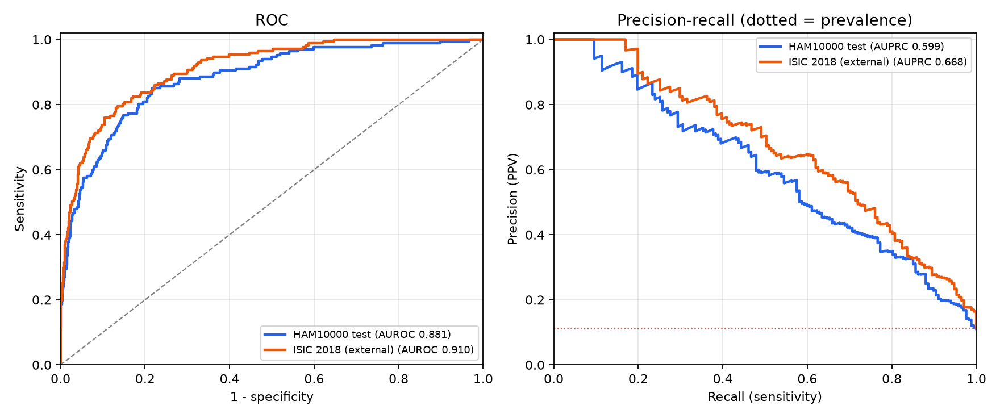
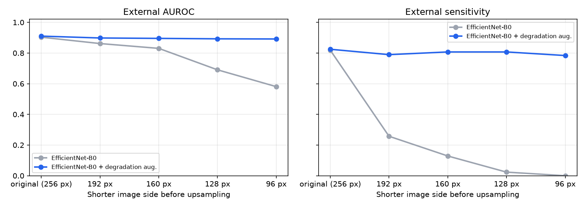
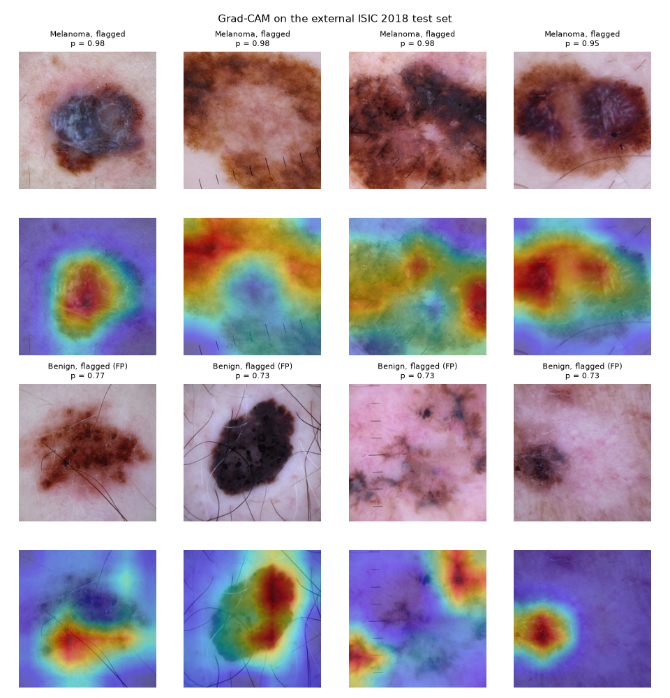
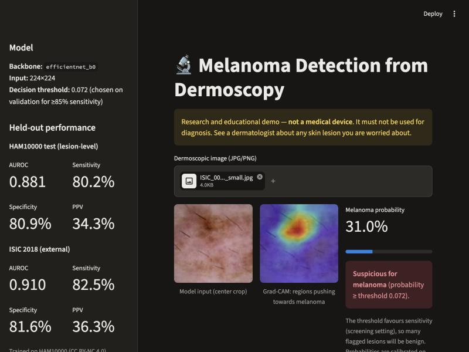

# Melanoma Detection from Dermoscopy

[](https://github.com/bariskiray/MedicalInformatics/actions/workflows/ci.yml)


Binary melanoma classifier for dermoscopic images, built around **leakage-free evaluation**:
lesion-level splits, an external test set, bootstrap confidence intervals, a stress test against
image degradation and Grad-CAM explanations. It is a rewrite of a course project whose reported numbers
turned out to be inflated (see [v1 → v2](#from-v1-to-v2-what-the-audit-found)).

> **Not a medical device.** Research and education only. It must not be used for diagnosis.

<p align="center"></p>

## Highlights

- **External AUROC 0.910** (95% CI 0.879–0.937) on the official ISIC 2018 test set. The model never saw
  it during training, model selection or threshold choice. The original v1 model scores 0.792 on the same set.
- **Lesion-level splitting.** The original image-level split put 34% of test images in the test set
  while another photo of the same lesion was in training. An ablation shows the leak inflates internal AUROC
  (0.930 vs. 0.898) without improving external performance at all.
- **Robust to resolution loss and compression.** Without degradation augmentation, melanoma sensitivity
  drops from 82% to 2% when images are downscaled to 128 px. With it, sensitivity stays at 81%.
- **Honest operating point.** The threshold is fixed on validation to reach ≥ 85% sensitivity. Every metric
  is computed at that one threshold and reported with lesion-cluster bootstrap 95% CIs.
- **Engineering:** pip-installable package, YAML configs, versioned split file, 28 unit tests, CI,
  Streamlit demo with Grad-CAM, and a [model card](MODEL_CARD.md).

## Results

### Main model: EfficientNet-B0 with degradation augmentation

Threshold 0.072, chosen on the validation set (target sensitivity 85%).

| Metric | HAM10000 test (lesion-level) | ISIC 2018 (external) |
|---|---|---|
| AUROC | 0.881 (0.833–0.919) | **0.910** (0.879–0.937) |
| AUPRC (prevalence ≈ 0.11) | 0.599 (0.492–0.685) | 0.668 (0.572–0.745) |
| Sensitivity | 80.2% (71.1–88.3) | 82.5% (75.6–88.8) |
| Specificity | 80.9% (78.2–83.6) | 81.6% (79.3–83.9) |
| PPV (precision) | 34.3% (27.9–40.3) | 36.3% (30.2–42.5) |
| NPV | 97.1% (95.6–98.3) | 97.3% (96.1–98.4) |
| Balanced accuracy | 80.6% (76.0–84.7) | 82.0% (78.3–85.4) |
| TP / FP / TN / FN | 134 / 257 / 1086 / 33 | 141 / 247 / 1093 / 30 |
| Images (melanoma) | 1510 (167) | 1511 (171) |

At this screening-oriented threshold, about **2 of every 3 flagged lesions are benign**. That is the
expected price of catching ~4 of 5 melanomas at an 11% prevalence. The full ROC/PR curves above show
the whole trade-off.

### Comparison and ablations

All rows use the same pipeline, threshold rule and test sets. External = ISIC 2018.

| Model | Split | Internal test AUROC | External AUROC | Ext. sens. | Ext. spec. | Ext. PPV |
|---|---|---|---|---|---|---|
| **EfficientNet-B0 + degradation aug. (main)** | lesion | 0.881 (0.833–0.919) | **0.910** (0.879–0.937) | 82.5% | 81.6% | 36.3% |
| EfficientNet-B0 | lesion | 0.898 (0.863–0.930) | 0.903 (0.875–0.930) | 81.9% | 80.0% | 34.3% |
| MobileNetV2, full fine-tune | lesion | 0.877 (0.836–0.914) | 0.913 (0.886–0.936) | 83.6% | 81.1% | 36.1% |
| MobileNetV2, frozen backbone (≈ v1 setup) | lesion | 0.807 (0.761–0.852) | 0.855 (0.817–0.889) | 87.1% | 63.4% | 23.3% |
| EfficientNet-B0, image-level split | image (leaky) | 0.930 (0.910–0.948) | 0.911 (0.880–0.937) | 77.8% | 84.6% | 39.2% |
| v1 Keras MobileNetV2 (original repo, thr. 0.3) | image (leaky) | 0.827 *(as reported)* | 0.792 (0.751–0.832) | 58.5% | 81.9% | 29.2% |

What the table shows:

- **Fine-tuning matters more than the backbone.** Unfreezing the backbone adds ~0.06 external AUROC.
  EfficientNet-B0 and MobileNetV2 perform the same within their CIs.
- **Leakage inflates internal numbers only.** The leaky split gives the best internal AUROC (0.930)
  but no better external AUROC than the lesion-level model. The internal metric was measuring memorised lesions.
- **v1 overstated its performance.** Its headline numbers mixed two thresholds (see below) and came from a
  leaky split. On external data, at the threshold the app actually used, it catches 58% of melanomas,
  not the claimed 78%.

### Robustness to image degradation

External set, threshold fixed. Each image is downscaled (or JPEG re-encoded) and then upsampled back to the
model input size.

<p align="center"></p>

| Condition | EfficientNet-B0 (AUROC / sens.) | + degradation aug. (AUROC / sens.) |
|---|---|---|
| Original (shorter side 256 px) | 0.903 / 82% | 0.910 / 82% |
| 192 px | 0.862 / 26% | 0.898 / 79% |
| 128 px | 0.690 / 2% | 0.893 / 81% |
| 96 px | 0.581 / 0% | 0.892 / 78% |
| JPEG quality 50 | 0.874 / 42% | 0.901 / 83% |
| JPEG quality 20 | 0.630 / 5% | 0.885 / 80% |

The baseline relies on fine texture that disappears as soon as an input is smaller than the training
resolution. It does not just rank worse: its probabilities collapse towards "benign", so almost every
melanoma falls below the threshold. A model like that fails silently on a slightly smaller upload.
Random downscaling (shorter side 96–256 px, p = 0.5) and JPEG re-encoding (quality 20–90, p = 0.5) during
training remove the problem at no cost on clean images, so this model is the main one.

### Explainability (Grad-CAM)

<p align="center"></p>

For the most confident true positives, attention usually lies on the lesion. Some false positives are
driven by regions outside the lesion, such as image corners or ruler marks. This hints at acquisition
artefacts the model can latch onto and is listed as a limitation below.

More figures: [calibration](reports/figures/calibration.png),
[training curves](reports/figures/training_history.png),
confusion matrices ([internal](reports/figures/confusion_test.png),
[external](reports/figures/confusion_external_isic2018.png)).
All numbers: [`reports/results.md`](reports/results.md), [`reports/metrics_main.json`](reports/metrics_main.json).

## Method

| | |
|---|---|
| Data | [HAM10000](https://doi.org/10.7910/DVN/DBW86T): 10,015 images, 7,470 lesions, 1,113 melanoma (11.1%) |
| Label | `mel` = 1, all other diagnoses (nv, bkl, bcc, akiec, vasc, df) = 0 |
| Split | Stratified by label at the **lesion** level, 70/15/15. Versioned in [`splits/`](splits/ham10000_lesion_split.csv) |
| External test | ISIC 2018 Task 3 test set (1,511 images available, 171 melanoma) |
| Preprocessing | Shorter side 256 px → 224 center crop, ImageNet normalisation |
| Augmentation | Random downscale + JPEG (p = 0.5 each), 180° rotation, random resized crop, flips, mild colour jitter |
| Model | `timm` EfficientNet-B0 (ImageNet), dropout 0.3, single logit. Output bias initialised to the class prior |
| Training | Full fine-tuning, AdamW (lr 2e-4, wd 1e-4), 1-epoch warmup + cosine decay, batch 32, plain BCE. Checkpoint chosen by validation AUROC, early stopping (patience 5) |
| Threshold | Highest threshold reaching ≥ 85% sensitivity on **validation**, then frozen |
| Inference | 4-way flip test-time augmentation |
| Uncertainty | Lesion-cluster bootstrap (1,000 resamples) for all CIs |

Training takes about 20 minutes on an Apple M1 Pro (PyTorch MPS backend).

## From v1 to v2: what the audit found

The original project (kept at tag [`v1.0`](https://github.com/bariskiray/MedicalInformatics/tree/v1.0))
reported 86.6% accuracy, 82.7% AUC and 77.8% melanoma recall. Re-checking it turned up four problems:

1. **Mixed thresholds.** Accuracy, precision and recall came from `model.evaluate()` at threshold 0.5.
   The confusion matrix and class-level metrics came from threshold 0.3. At the 0.3 threshold the app used,
   accuracy was 75.0%, not 86.6%. At 0.5, melanoma recall was 40.7%, not 77.8%.
2. **Fine-tuning never happened.** The unfreeze routine looked for a nested MobileNetV2 layer that does not
   exist in a functional Keras model. It fell back to `model.trainable = True`, which in Keras 3 does not
   re-enable the frozen sub-layers. The saved model has 153 of 161 layers frozen.
3. **Lesion leakage.** Images were split independently, so 34.2% of test images had their lesion in the
   training set.
4. **Documentation drift.** Data paths, directory layout, epoch counts (28 epochs ran in total, not 30 + 10)
   and dates did not match the code.

v2 fixes all four. It also reports the v1 model on the same external test set
([`scripts/evaluate_v1_external.py`](scripts/evaluate_v1_external.py)) for a fair comparison.

While building v2 I found and fixed one more issue in my own pipeline. `timm` initialises a
one-unit classifier with weights drawn from U(−1, 1), which produced an initial loss of ~2 and crippled the
frozen-backbone baseline. The output layer is now initialised to the class prior, and this is unit-tested.
All reported runs use the fixed initialisation.

## Quick start

```bash
git clone https://github.com/bariskiray/MedicalInformatics.git
cd MedicalInformatics
python -m venv .venv && source .venv/bin/activate
pip install -e ".[app,dev]"
```

**Run the demo** with the released weights:

<p align="center"></p>


```bash
mkdir -p models && curl -L -o models/melanoma_effnet_b0.pt \
  https://github.com/bariskiray/MedicalInformatics/releases/download/v2.0.0/melanoma_effnet_b0.pt
streamlit run app/streamlit_app.py
```

**Reproduce everything** (≈ 300 MB of data, ~2 h on an M1 Pro):

```bash
make data         # HAM10000 + ISIC 2018 test set from Harvard Dataverse, resized to 256 px
make train        # main model  -> runs/effnet_b0_lesion_robust/
make ablations    # comparison rows of the table above
make robustness   # degradation stress test
make report       # reports/ tables and figures, models/ checkpoint for the app
make test         # unit tests
```

Single experiments can be changed from the command line, for example
`python -m melanoma.train --set experiment=effnet_b2 model.name=efficientnet_b2 train.epochs=30`.

## Project structure

```
├── app/streamlit_app.py        # demo: probability, decision, Grad-CAM overlay
├── configs/default.yaml        # main experiment (everything else = command-line overrides)
├── scripts/
│   ├── download_data.py        # parallel download + resize from Harvard Dataverse
│   ├── robustness.py           # resolution / JPEG stress test
│   ├── evaluate_v1_external.py # scores the original v1 Keras model on ISIC 2018
│   └── make_report.py          # tables, figures, Grad-CAM gallery
├── splits/                     # versioned lesion-level split
├── src/melanoma/
│   ├── data.py                 # metadata, lesion-level splitting, transforms, dataset
│   ├── model.py                # timm model, head init, checkpoints
│   ├── engine.py               # training loop, TTA inference
│   ├── metrics.py              # threshold selection, metrics, cluster bootstrap
│   ├── gradcam.py              # Grad-CAM for timm CNNs
│   ├── train.py / evaluate.py  # CLIs
│   └── plots.py
├── tests/                      # pytest: splits, metrics, model, Grad-CAM
├── reports/                    # committed results and figures
└── MODEL_CARD.md
```

## Limitations

- **Population and device bias.** HAM10000 is mostly fair-skinned patients from two centres. Performance on
  darker skin types and other dermatoscopes is unknown. Smartphone or clinical photos are out of scope.
- **Low PPV.** At ~82% sensitivity, roughly 64% of positive calls are false alarms.
- **Spurious cues.** Grad-CAM shows some decisions driven by non-lesion regions.
- **Calibration.** Probabilities are reasonably calibrated but slightly conservative: the observed melanoma
  rate sits a little above the predicted probability (see the [calibration plot](reports/figures/calibration.png)).
  They assume the ~11% melanoma prevalence of HAM10000.
- **Binary task.** BCC and AKIEC (also malignant or pre-malignant) belong to the negative class here.
- **Variance.** Single training seed per configuration. Differences inside the CIs are not meaningful.

See the [model card](MODEL_CARD.md) for intended use and risks.

## Data, license and citation

Code: MIT. HAM10000 and the ISIC 2018 test set are licensed **CC BY-NC 4.0**, so the trained weights
are for non-commercial use only. If you use the data, cite:

> Tschandl, P., Rosendahl, C. & Kittler, H. The HAM10000 dataset, a large collection of multi-source
> dermatoscopic images of common pigmented skin lesions. *Sci. Data* 5, 180161 (2018).

> Codella, N. et al. Skin Lesion Analysis Toward Melanoma Detection 2018: A Challenge Hosted by the
> International Skin Imaging Collaboration (ISIC). arXiv:1902.03368 (2019).
